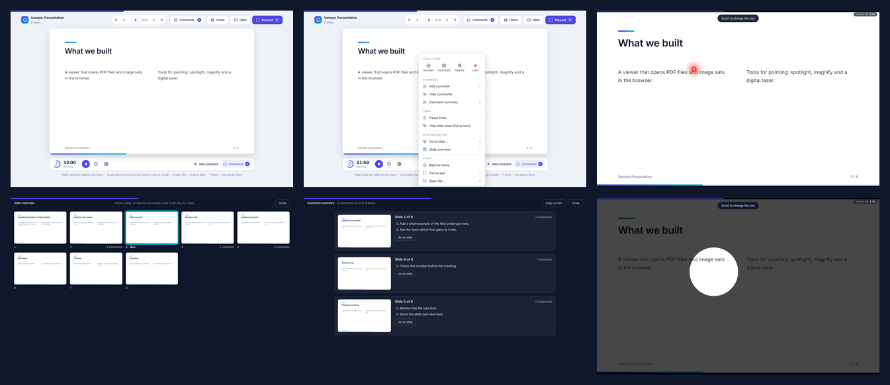
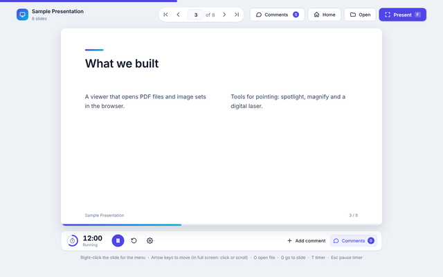
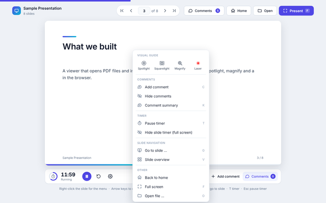
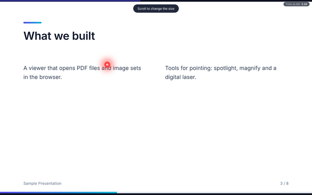
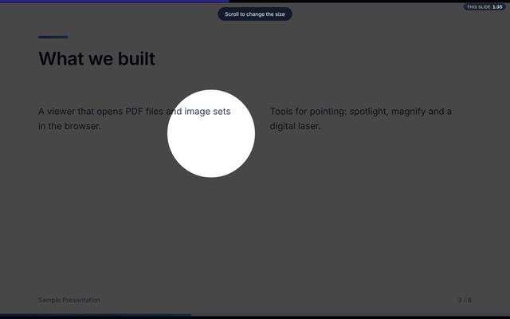
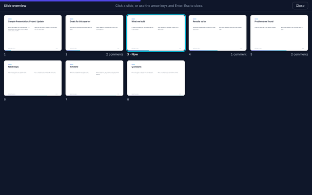
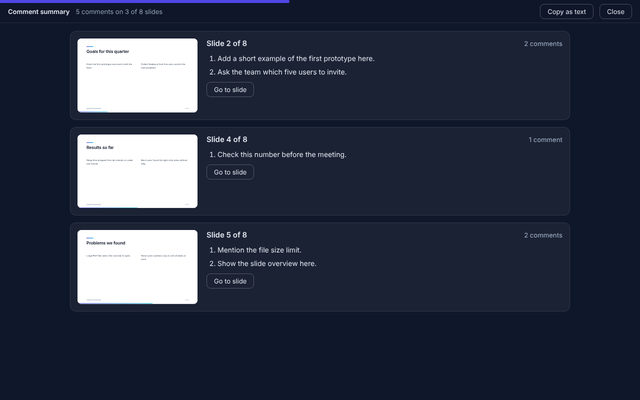
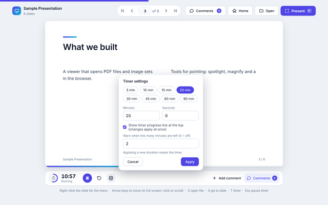
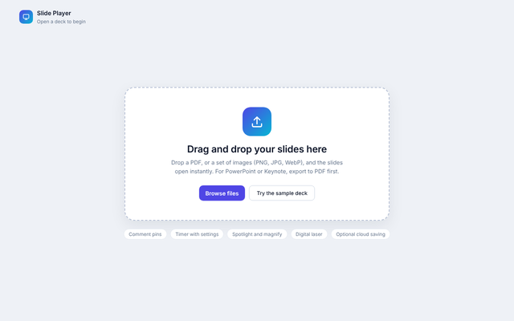

# Slide Player

A single-file slide player for the browser. Open a PDF, a set of images or a small JSON deck, then present it with a timer, pointing tools and comment pins. No build step and no server are needed.



All pictures in this page were taken from the demo deck in `samples/demo-deck.json`. They do not show anyone's real files.

## Features

| | |
|---|---|
| [](docs/screenshots/02-slide-view.png) **Slide view.** Timer, slide navigation, comment count and a progress line across the top while the timer runs. | [](docs/screenshots/03-right-click-menu.png) **Right-click menu.** Visual guide tools first, then comments, timer, slide navigation and other actions. |
| [](docs/screenshots/04-full-screen-laser.png) **Digital laser.** Scroll to make the dot smaller or larger. The corner clock shows the time spent on the current slide. | [](docs/screenshots/05-spotlight.png) **Spotlight, squarelight and magnify.** Scroll to change the size. |
| [](docs/screenshots/06-slide-overview.png) **Slide overview.** See every slide, jump to one with a click or the arrow keys. Slides with comments show a count. | [](docs/screenshots/07-comment-summary.png) **Comment summary.** Only the slides that have comments, with the slide number and each comment as text. Copy it as plain text. |
| [](docs/screenshots/08-timer-settings.png) **Timer settings.** Set the duration, a warning time, and turn the progress line on or off. | [](docs/screenshots/01-start-screen.png) **Start screen.** Drop a file, browse, or try the sample deck. |

Other behavior:

- The presentation timer pauses with **Esc**. The slide timer restarts at every slide change and has a reset button on hover in full screen.
- Home returns to the start screen. The comment summary and slide overview can be opened at any time.
- Comments are pinned to a spot on a slide and are kept per file in the browser.

## Run it

Open `index.html` in a current browser. To use the demo deck, press **Open** and choose `samples/demo-deck.json`, or press **Try the sample deck** on the start screen.

A deck can also be a PDF or a set of PNG, JPG or WebP images. For PowerPoint or Keynote, export to PDF first.

### Demo deck format

```json
{
  "title": "My deck",
  "slides": [
    { "title": "First slide", "cols": ["Left column text", "Right column text"] }
  ]
}
```

## Keyboard shortcuts

| Key | Action |
|---|---|
| Arrow keys, Page Up, Page Down, Space | Move between slides |
| Home, End | First or last slide |
| F | Full screen |
| G | Go to a slide number |
| V | Slide overview |
| K | Comment summary |
| C | Add a comment at the pointer |
| T | Start or pause the timer |
| S, Q, M, L | Spotlight, squarelight, magnify, laser (full screen) |
| O | Open a file |
| Esc | Close a panel, pause the timer, leave full screen |

## Cloud saving (optional)

Saving opened files to the cloud and reopening the last file on start only work when the page is published as a Claude artifact, because they use that platform's storage. When the page runs from a plain file or another web host, those parts stay hidden and everything else works as normal.

## Notes

- Files you open stay in your browser. Nothing is uploaded unless cloud saving is available and turned on.
- The page includes a copy of PDF.js from Mozilla (Apache License 2.0) to read PDF files.
- Fonts are requested from Google Fonts when online and fall back to system fonts when offline.
